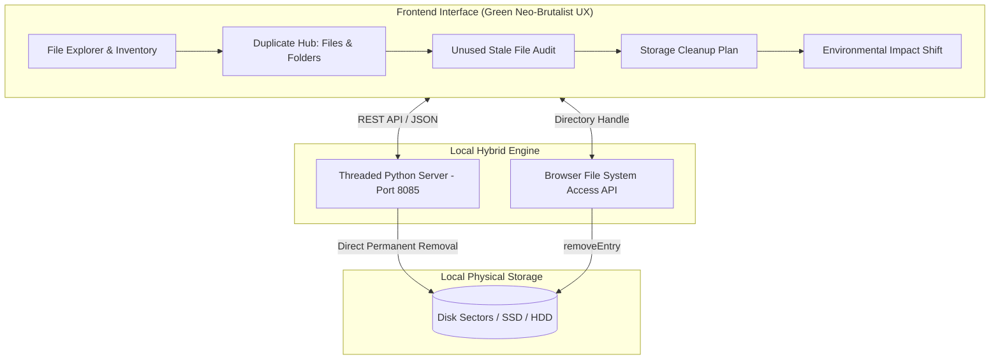

# 🌱 GreenFile – Code Green for Your Storage
> **Smart Digital Storage Deduplication & Environmental Carbon Accounting Engine**

[](https://greensoftware.foundation/)
[](https://python.org)
[](https://developer.mozilla.org/)
[](LICENSE)

---

## 📖 Table of Contents
1. [Executive Summary](#-executive-summary)
2. [The Problem: Dark Data & The Invisible Carbon Footprint](#-the-problem-dark-data--the-invisible-carbon-footprint)
3. [Green Computing Efficiency & Environmental Calculations](#-green-computing-efficiency--environmental-calculations)
4. [Core Architectural Features](#-core-architectural-features)
5. [System Architecture & Workflow](#-system-architecture--workflow)
6. [Getting Started & Usage](#-getting-started--usage)
7. [Green Software Foundation (GSF) Alignment](#-green-software-foundation-gsf-alignment)
8. [Benchmarking Methodology](#-benchmarking-methodology)

---

## 🌿 Executive Summary

**GreenFile** is a privacy-first, local-first storage optimization and carbon-accounting platform designed to tackle **digital storage waste**. 

While modern sustainability initiatives focus heavily on algorithmic complexity and cloud virtualization, digital storage consumption remains an overlooked contributor to carbon emissions and electronic waste (e-waste). GreenFile combines **cryptographic file-level and directory-level deduplication** with **rigorous green software accounting**—translating reclaimed disk sectors into quantifiable annual reductions in kilowatt-hours ($\text{kWh}$) and greenhouse gas emissions ($\text{CO}_2$).

---

## 🏭 The Problem: Dark Data & The Invisible Carbon Footprint

According to global data management studies, **over 52% of all data stored worldwide is "Dark Data"**—unmodified, redundant, forgotten, or duplicate files that continue to occupy physical storage blocks without offering utility.

```
+-------------------------------------------------------------------------+
|                        THE DARK DATA CYCLE                              |
|                                                                         |
|   Duplicate Files & Stale Data  --->  Drive Fills Up to 90%+ Capacity  |
|                 |                                   |                   |
|                 v                                   v                   |
|   Continuous Cloud Sync Overhead      Accelerated SSD Wear (Flash Writes)|
|                 |                                   |                   |
|                 v                                   v                   |
|   Multiplied Data Center Power        Premature Drive Replacement       |
|   (Cooling, RAID, Replication)        (High Embodied Carbon & E-Waste)  |
+-------------------------------------------------------------------------+
```

Every byte stored locally has an ongoing environmental cost:
1. **Embodied Carbon & Hardware Lifespan**: Solid-State Drives (SSDs) have finite write endurance measured in *Terabytes Written* (TBW). When drives operate near full capacity, flash controller wear-leveling algorithms must frequently shuffle blocks, triggering high write amplification that wears out flash memory cells prematurely.
2. **Cloud Replication Multiplier**: Standard desktop folders (`Documents`, `Downloads`, `Desktop`) are frequently mirrored to cloud storage providers (OneDrive, Google Drive, iCloud, Dropbox). Every 1 GB of local redundant data is multiplied into **3 to 5 GB of remote enterprise storage** across geographically distributed data centers, requiring 24/7 power and cooling.
3. **Continuous Background Indexing**: Operating system search indexers (Windows Search, macOS Spotlight) and antivirus daemons constantly re-index and scan stagnant directories, consuming continuous CPU and memory cycles.

---

## ⚡ Green Computing Efficiency & Environmental Calculations

GreenFile provides transparent, verifiable mathematical formulas to calculate environmental impact:

### 1. Drive Efficiency Metric
$$\text{Drive Efficiency (\%)} = \left( 1 - \frac{\text{Recoverable Storage Waste (GB)}}{\text{Total Analyzed Storage (GB)}} \right) \times 100$$

* Identifies the percentage of active storage representing genuine utility vs. redundant waste.

### 2. Annual Energy Conservation Model
$$E_{\text{saved}} = \Delta S \times \alpha$$

* $\Delta S$: Physical storage freed from disk ($\text{GB}$).
* $\alpha$: Storage energy consumption factor ($0.015\text{ kWh / GB / year}$), reflecting continuous read/write overhead, active sector refresh, bus power, and secondary backup overhead.

### 3. Greenhouse Gas Emission Reduction Model
$$C_{\text{reduced}} = E_{\text{saved}} \times \beta$$

* $E_{\text{saved}}$: Calculated energy savings ($\text{kWh}$).
* $\beta$: Global electrical grid carbon intensity benchmark ($0.385\text{ kg CO}_2\text{ / kWh}$).

### 4. Cloud Backup Factor (Data Center Replication Multiplier)
$$\Delta S_{\text{cloud}} = \Delta S \times R_f$$

* $R_f$: Cloud Replication Factor ($3\times$ to $5\times$).
* Reclaiming 10 GB of redundant files on a cloud-synced local folder saves up to **50 GB of remote data center allocations**, along with corresponding enterprise PUE (Power Usage Effectiveness) overheads.

---

## 🛠️ Core Architectural Features

### 🔍 Multi-Layer Deduplication Engine
* **SHA-256 Bit-for-Bit File Deduplication**: Employs file-size candidate grouping followed by cryptographic hashing. For files exceeding 256 MB, it utilizes a dual head-and-tail byte-window technique to eliminate disk I/O bottlenecks without sacrificing precision.
* **Structural Directory Tree Hashing**: Identifies identical directory branches by computing a recursive content signature hash (`sig_hash`) over relative item paths, sizes, and content signatures, allowing whole duplicate folders to be cleaned in a single action.
* **Name-Matched Heuristic Detection**: Detects file copies across disparate folders that share normalized base names (e.g., stripping `(1)`, `- Copy`, `_backup`).
* **Zero-Byte Empty Folder Auditing**: Locates abandoned directory nodes consuming filesystem table space and inode indices.

### 🗑️ Hybrid Safe Deletion Architecture
* **Direct 1-Click Disk Deletion**: Every suspect file record features an immediate `🗑️ Delete Now` trigger alongside granular batch selection toggles (`[ Mark Delete | Keep ]`).
* **Multi-Engine Execution**:
  1. *Native Python Engine*: Uses recursive read-only attribute unlocking (`os.chmod`) and Windows PowerShell fallback (`Remove-Item -Force -Recurse`) to bypass locked attributes.
  2. *W3C File System Access API*: Supports in-browser directory handle traversal (`removeEntry`) for cross-platform zero-dependency operation.
* **Smart Path Resolution**: Resolves relative paths automatically across the user profile, `Downloads`, `Documents`, and `Desktop` folders.

---

## 🏗️ System Architecture & Workflow



---

## 🚀 Getting Started & Usage

### Prerequisites
* **Python 3.8+** (installed and added to system `PATH`)
* Any modern web browser (Edge, Chrome, Firefox, Safari)

### Quick Launch (Windows)
Double-click `start.bat` or run:
```powershell
python server.py
```
* The server will automatically bind to `http://127.0.0.1:8085/` and open your default browser.
* Direct disk deletion, native directory scanning, and environmental computation will be active.

### Running in Standalone Browser Mode
* If running without the Python backend, simply double-click `GreenFile – Code Green for Your Storage.html` in your browser.
* The application runs in **Browser Mode** utilizing the File System Access API.

---

## 🏆 Green Software Foundation (GSF) Alignment

GreenFile directly incorporates the core tenets of the **Green Software Foundation Principles**:

| GSF Principle | GreenFile Implementation |
| :--- | :--- |
| **Carbon Efficiency** | Minimizes greenhouse gas emissions per unit of computing storage. |
| **Energy Efficiency** | Cuts active read/write cycles, indexing operations, and background backup scans. |
| **Embodied Carbon** | Prolongs hardware lifespan (SSD wear leveling & write limits), reducing the rate of device obsolescence. |
| **Measurement & Transparency** | Quantifies reclaimed storage into measurable $\text{kWh}$ energy and $\text{g CO}_2$ equivalents. |

---

## 📊 Benchmarking Methodology

* **Energy Factor Benchmark**: Modeled on standard enterprise and personal storage benchmarks ($0.015\text{ kWh/GB/year}$ for active-tier local SSD/HDD storage overhead).
* **Carbon Intensity Benchmark**: Average global grid emission factor ($0.385\text{ kg CO}_2\text{/kWh}$) sourced from IEA (International Energy Agency) and GSF standards.
* **Cryptographic Verification**: SHA-256 guarantees zero false positives when identifying duplicate content.

---

## 📜 License
This project is open-source under the [MIT License](LICENSE). 

*Code Green for Your Storage. Built for Sustainable Computing.*
